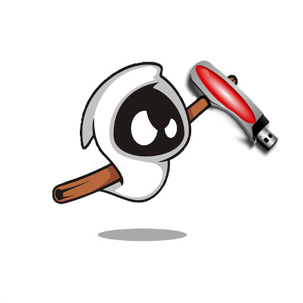
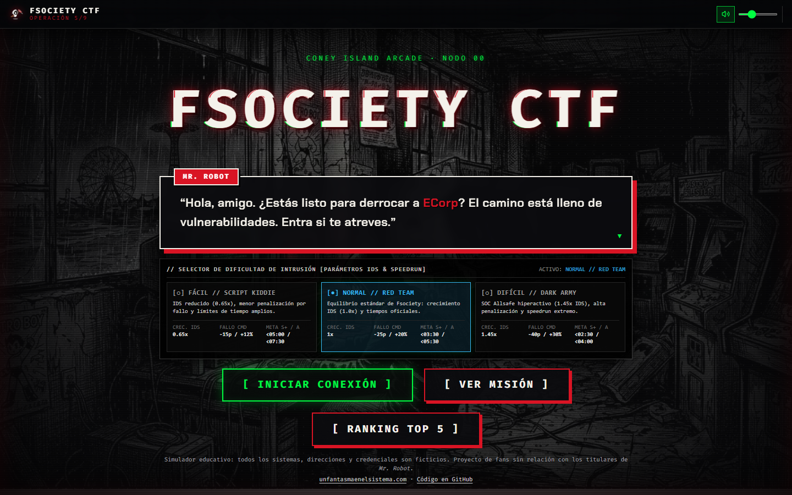
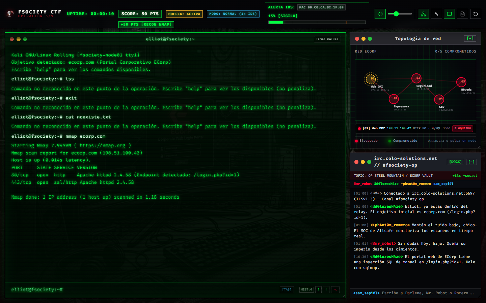
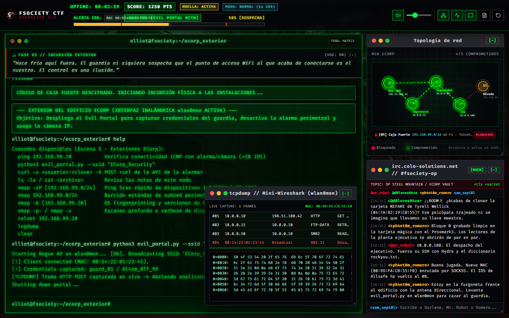
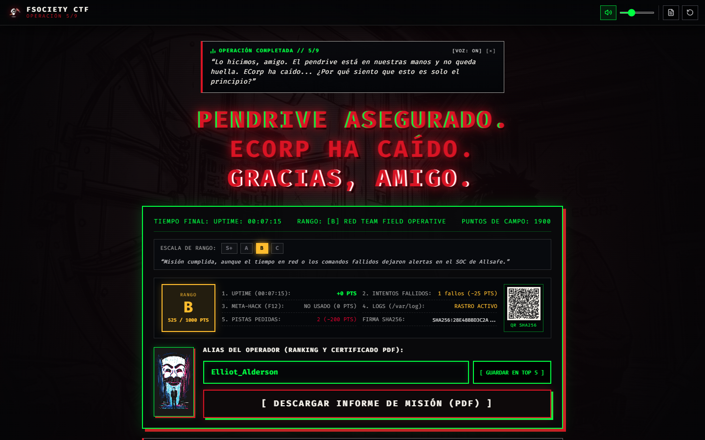

<p align="center">
  <a href="https://www.unfantasmaenelsistema.com/"></a>
</p>

<h1 align="center">Fsociety CTF · Operación 5/9</h1>

<p align="center">
  Juego <em>Capture The Flag</em> que se juega entero en el navegador: seis fases de intrusión encadenadas desde una terminal Kali simulada.
</p>

<p align="center">
  <a href="https://unfantasmaenelsistema.github.io/FsocietyCTF/"><strong>▶ Jugar ahora</strong></a>
  ·
  <a href="https://www.unfantasmaenelsistema.com/">unfantasmaenelsistema.com</a>
</p>

<p align="center">
  
  
  
  
  
</p>



## Qué es

Encarnas a un operador de fsociety que debe llegar hasta la cámara acorazada de ECorp. No hay servidores ni máquinas reales: todo (red, servicios, credenciales y respuestas de las herramientas) está simulado en el cliente, así que puede usarse en clase sin instalar nada y sin riesgo.

La partida se guarda en el navegador, puntúa cada acción y termina con un rango (S+, A, B o C), un ranking local y un certificado en PDF con código QR.

> **Simulador educativo.** Todos los sistemas, direcciones y credenciales son ficticios. Es un proyecto de fans sin relación con los titulares de *Mr. Robot*.

## Las seis fases

| Fase | Objetivo | Técnica que se practica |
| :-- | :-- | :-- |
| 1 · Brecha perimetral | Portal web de ECorp | Reconocimiento con `nmap` e inyección SQL con `sqlmap` |
| 2 · Red interna | Impresora de la subred | Descubrimiento de hosts y FTP anónimo |
| 3 · Servidor de seguridad | Control de accesos | Enumeración SMB y clonado de tarjeta RFID |
| 4 · Despacho del CEO | Estación de trabajo | Fuerza bruta SSH y decodificación Base64 |
| 5 · Perímetro exterior | Alarma y cámara IP | Portal cautivo Wi-Fi, API sin proteger y credenciales por defecto en IoT |
| 6 · Cámara acorazada | Controlador de la bóveda | Acceso por puerto serie |

Cada fase deja en el sistema de archivos del nodo notas e historiales (`ls -la`, `cat`) con las pistas necesarias para la siguiente.

## Cómo se juega



- **Terminal**: escribe `help` para ver los comandos de la fase. Tiene autocompletado con `Tab`, historial con `↑` / `↓`, `Ctrl+L` para limpiar y `Ctrl+C` para abortar.
- **Alerta IDS**: los escaneos y los ataques mal dirigidos hacen ruido. Al 100 % la terminal se bloquea hasta que rotes tu identidad con `macchanger -r wlan0mon`. Un comando mal tecleado no penaliza.
- **Pistas**: `hint` pide ayuda a Darlene a cambio de puntos y tiempo.
- **Mapa de red**: muestra los cinco nodos y cuáles están ya comprometidos.
- **IRC**: el equipo comenta tus avances y responde si le escribes.
- **Sniffer**: `tcpdump` abre un analizador de paquetes con las tramas capturadas.
- **Monitor**: `top` abre un monitor de procesos en vivo.
- **Dificultad**: fácil, normal o difícil; cambia la sensibilidad del IDS, la penalización por fallo y los tiempos para cada rango.



Hay extras para quien explore: borrar huellas antes de salir mejora el rango, y el propio código de la página esconde una puerta trasera.



## Ejecutarlo en local

Requiere [Bun](https://bun.sh/) (o Node.js 20+ con npm).

```bash
git clone https://github.com/unfantasmaenelsistema/FsocietyCTF.git
cd FsocietyCTF
bun install
bun run dev
```

Abre `http://localhost:3000`. Otros comandos: `bun run build` (genera `dist/`) y `bun run lint` (comprueba los tipos).

Añadir `?dev` a la URL muestra atajos para saltar de fase, útiles al desarrollar.

## Estructura

```text
├── public/assets/      Fondos de cada fase, emblema, logo y música ambiente
├── src/App.tsx         Máquina de estados del juego, intérprete de comandos e interfaz
├── src/index.css       Estética (manga oscuro, CRT, temas de terminal)
├── src/layout.css      Distribución: barra superior y ventanas
└── .github/workflows/  Publicación en GitHub Pages
```

## Licencia

[Apache 2.0](LICENSE). Un proyecto de [Un Fantasma en el Sistema](https://www.unfantasmaenelsistema.com/).
