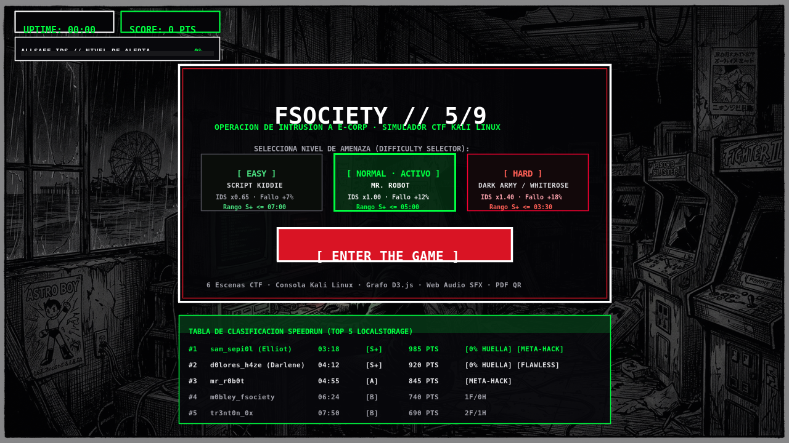
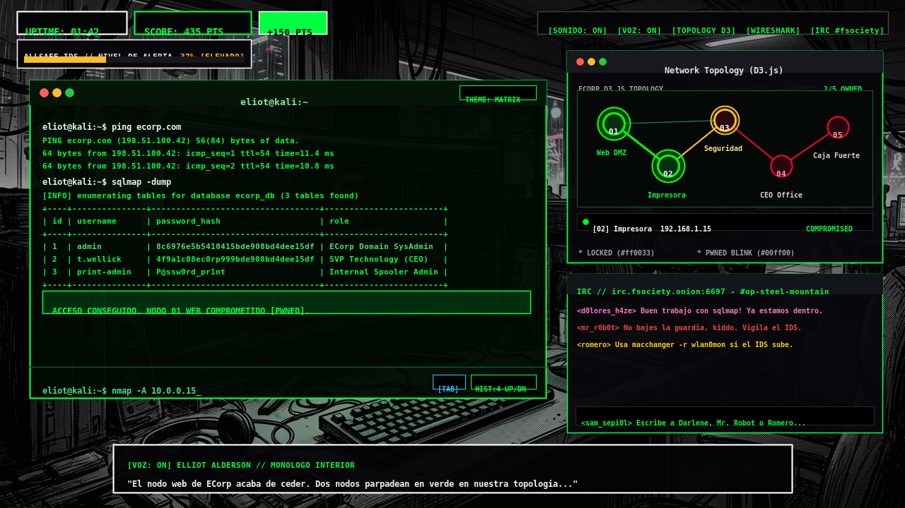
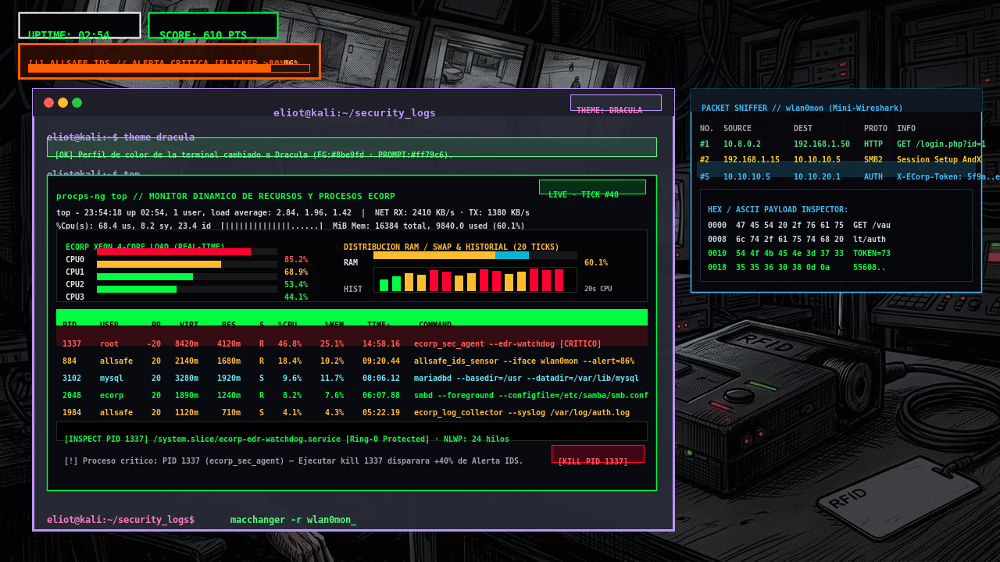
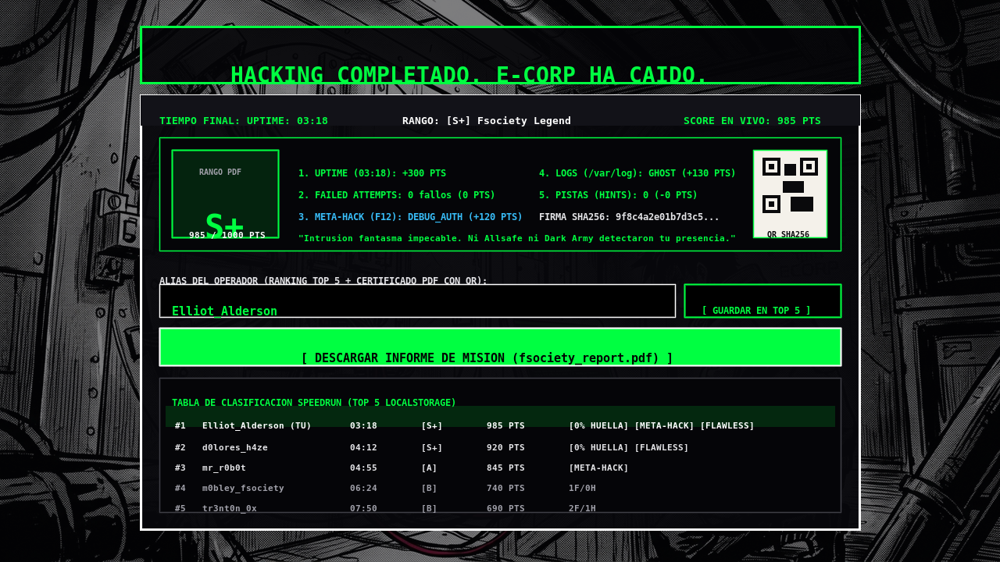

# 🎭 Fsociety // Operación 5/9 — Interactive CTF & Kali Linux Simulator

<p align="center">
  
</p>

<p align="center">
  
  
  
  
  
  
</p>

> **“Hello, friend.”**
> **Fsociety // Operación 5/9** es una aplicación web interactiva **Capture The Flag (CTF)** ejecutada íntegramente en el cliente (*client-side*), inspirada en *Mr. Robot* con dirección de arte de novela gráfica *seinen* oscura. Pon a prueba tus habilidades de *pentesting*, movimiento lateral, evasión de IDS y criptografía a través de 6 escenarios interconectados hasta comprometer la cámara acorazada de **E-Corp**.

---

## 📸 Capturas Reales de la Aplicación

### 1. Pantalla de Inicio, Selector de Dificultad y Tabla de Clasificación Speedrun
Configura el nivel de amenaza del Blue Team (**EASY · Script Kiddie**, **NORMAL · Mr. Robot**, **HARD · Dark Army / Whiterose**) y consulta el Top 5 histórico persistido en `localStorage`.


---

### 2. Consola Kali Linux, Topología Interactiva en D3.js (`#network-map`) y Chat IRC (`#fsociety-irc`)
Entorno de ventanas flotantes redimensionables y arrastrables con terminal CRT, grafo de fuerzas interactivo en **D3.js** (donde los nodos comprometidos parpadean en verde neón `#00ff00`), chat IRC en vivo con Darlene, Mr. Robot y Romero, y monólogo interior de Elliot con síntesis de voz.



---

### 3. Monitor Dinámico `top` en Tiempo Real, Perfiles de Color (`theme`) y Alerta IDS >80% (`#ff5f00`)
Monitorización en vivo de los 4 núcleos Xeon de ECorp, distribución de memoria RAM/Swap, histograma de 20 segundos, tabla interactiva de procesos con protección kernel EDR (`PID 1337`), analizador de paquetes **Mini-Wireshark** (`#packet-sniffer`), temas de terminal (`Matrix`, `Dracula`, `Monokai`) y parpadeo crítico naranja (`#ff5f00`) cuando el IDS supera el 80%.



---

### 4. Pantalla de Victoria (`5/9`), Evaluación de Rango (`S+`), Código QR SHA-256 e Informe PDF
Al comprometer los 5 nodos de ECorp se calcula la calificación final (`S+`, `A`, `B`, `C`), se genera un código QR vectorial de verificación criptográfica y se permite descargar el certificado oficial en PDF (`fsociety_report.pdf`) generado con `jsPDF`.



---

## ✨ Características Principales

- 🖥️ **Emulador de Terminal Kali Linux con VFS Completo**:
  - Sistema de archivos virtual (VFS) específico por escena con soporte para `ls -la`, `cat`, `pwd`, `cd`, lectura de archivos ocultos (`.bash_history`, `.ssh/known_hosts`, notas de auditoría).
  - **Autocompletado inteligente con la tecla `Tab`** para comandos de red (`nmap`, `ping`, `sqlmap`, `smbclient`, `hydra`, `ssh`, `proxmark3`, `minicom`, `theme`) y archivos del directorio virtual actual.
  - **Historial de comandos persistente en estado** navegable con las teclas `↑` / `↓`, consulta mediante `history` y limpieza total de estado, índice y borrador con `history -c`.
  - Atajos nativos de terminal: `Ctrl + L` (limpiar pantalla) y `Ctrl + C` (abortar proceso en ejecución).
- 🌐 **Topología de Red Interactiva con D3.js (`#network-map`)**:
  - Representación visual de fuerzas (`d3.forceSimulation`, `d3.forceLink`, `d3.drag`) de los 5 nodos de la infraestructura de ECorp (`01 Web DMZ`, `02 Impresora`, `03 Seguridad`, `04 CEO Office`, `05 Caja Fuerte`).
  - Los nodos comprometidos parpadean en verde (`#00ff00` / `#00ff41`) con halos expansivos y flujo de paquetes animados a través de los enlaces de red.
- 📊 **Monitor Dinámico de Procesos y Recursos en Tiempo Real (`top` / `htop`)**:
  - Vista de consumo de recursos en vivo con barras de progreso para los **4 núcleos Xeon (`CPU0`–`CPU3`)**, memoria **RAM (`16384 MiB`)**, **Swap (`4096 MiB`)**, tráfico de red (`NET RX/TX KB/s`), disco (`DISK R/W MB/s`) e histograma (*sparkline*) de los últimos 20 segundos.
  - Tabla interactiva con 8 demonios del ecosistema ECorp ordenables por `%CPU`, `%MEM`, `PID` o `TIME+` y filtrables por usuario (`ALL`, `root`, `allsafe`, `ecorp`, `mysql`).
  - **Protección EDR Anti-Tamper (`PID 1337`)**: Intentar ejecutar `kill 1337` o `kill -9 1337` sobre `ecorp_sec_agent` activa el *watchdog* del kernel e incrementa el nivel de alerta IDS en **+40%**.
- 🎨 **Perfiles de Color de Terminal (`theme <name>`)**:
  - Cambia dinámicamente la paleta de `#kali-terminal` entre **`Matrix`**, **`Dracula`** y **`Monokai`** sin alterar la estética general del juego ni el HUD exterior.
- 🛡️ **Mecánicas Blue Team / Sensor IDS de Allsafe (`#ids-alert-hud`)**:
  - Barra de alerta de intrusión (0% a 100%) que reacciona al ruido de tus escaneos (`nmap -A`, `sqlmap -dump`, fallos de comandos).
  - **Estado Crítico (>80%)**: Cuando la alerta supera el 80%, la barra cambia a **naranja vibrante (`#ff5f00`)** con una animación de parpadeo (*flicker*) agresiva antes del bloqueo de terminal al 100%.
  - **Contramedidas de Evasión**: Rotación de dirección MAC con `macchanger -r wlan0mon`, uso de `proxychains`, borrado forense de huellas con `shred -u /var/log/auth.log` o `rm -rf /var/log/*` (bonificación *Ghost Operator*) y modo oculto **`god_mode`** (30 segundos de inmunidad IDS tras resolver el acertijo criptográfico con `unlock_god`).
- 🔊 **Efectos de Sonido Sintetizados (Web Audio API) y Motor de Paranoia**:
  - Sintetizador de audio en tiempo real sin dependencias externas: sonido mecánico de *bip* al teclear, acorde ascendente de éxito y zumbido disonante de error, además de música ambiental y síntesis de voz (`speechSynthesis`) para los monólogos interiores de Elliot.
- 📄 **Generador de Informe de Misión PDF (`jsPDF`) + QR Vectorial (`qrcode`)**:
  - Al finalizar la operación, expide un documento `fsociety_report.pdf` con el emblema oficial de Fsociety, desglose de métricas (`UPTIME`, fallos, Meta-Hacks F12, limpieza de logs), firma SHA-256 y código QR verificable.

---

## 🗺️ Arquitectura de las 6 Escenas del CTF

| Escena | Nodo Objetivo | IP / Host | Vector de Ataque Principal |
| :--- | :--- | :--- | :--- |
| **Escena 0** | Arcade Fsociety (Coney Island) | `10.8.0.2` | Selección de dificultad (`EASY`, `NORMAL`, `HARD`) e inicio de operación |
| **Escena 1** | `01` Servidor Web DMZ | `ecorp.com` (`192.168.1.50`) | Reconocimiento `nmap` / `ping` + Inyección SQL automatizada (`sqlmap -dump`) |
| **Escena 2** | `02` Impresora de Red Interna | `10.0.0.15` (`192.168.1.15`) | Acceso FTP anónimo (`ftp 10.0.0.15`) + Exfiltración de `config_backup.bak` |
| **Escena 3** | `03` Servidor de Seguridad Allsafe | `10.0.0.50` (`10.10.10.5`) | Enumeración SMB (`smbclient`) + Clonado RFID con `proxmark3` |
| **Escena 4** | `04` Despacho del CEO (Planta 44) | `10.0.0.100` (`10.10.20.1`) | Fuerza bruta SSH (`hydra`) + Decodificación `base64 -d` del PIN de la bóveda |
| **Escena 5** | `05A` Perímetro Exterior Steel Mountain | `192.168.99.0/24` | Portal cautivo Wi-Fi, `aireplay-ng`, API `curl` de alarma y `telnet` a cámara IP |
| **Escena 6** | `05B` Cámara Acorazada (Vault) | `/dev/ttyUSB0` (`10.10.99.99`) | Conexión serie UART (`minicom` / `screen 9600`) + Inyección del PIN de 7 dígitos |

---

## ⌨️ Comandos Globales de la Terminal

| Comando | Descripción | Impacto IDS |
| :--- | :--- | :--- |
| `help` | Muestra los comandos disponibles para el nodo y escena actual | `0%` |
| `ping <host>` | Envía una ráfaga de 4 paquetes ICMP en tiempo real con estadísticas RTT | `+2%` |
| `nmap <host>` | Escaneo estándar de puertos abiertos en el objetivo | `+8%` |
| `nmap -sP <subnet>` | Ping Scan rápido de descubrimiento de hosts activos en la subred | `+5%` |
| `nmap -v <host>` | Escaneo con verbosidad extendida y pistas de scripts NSE | `+18%` |
| `nmap -p- <host>` | Escaneo profundo de los 65.535 puertos TCP (revela puertos ocultos) | `+20%` |
| `nmap -A <host>` | Escaneo agresivo con detección de SO, versiones y traceroute | `+25%` |
| `sqlmap -dump` | Enumera tablas y extrae toda la base de datos `ecorp_db` (retraso de 3s) | `+35%` |
| `top` / `htop` | Abre el monitor dinámico de procesos y recursos de ECorp en tiempo real (`top -s mem`, `top -u root`) | `0%` |
| `kill <pid>` | Intenta finalizar un proceso (`kill 1337` dispara el watchdog del kernel EDR) | `+40%` |
| `theme <name>` | Cambia el perfil de color de la terminal (`Matrix`, `Dracula`, `Monokai`) | `0%` |
| `history` / `history -c` | Muestra el historial de comandos o lo vacía por completo (`history -c`) | `0%` |
| `macchanger -r wlan0mon` | Rota la dirección MAC del operador y reduce la alerta IDS acumulada | `-35%` |
| `shred -u /var/log/auth.log` | Borra las huellas forenses en los registros del servidor antes de la extracción | `-15%` |
| `tcpdump -i wlan0mon -X` | Abre el analizador de paquetes flotante **Mini-Wireshark** (`#packet-sniffer`) | `0%` |
| `logdump` | Vuelca los registros de auditoría SIEM (`/var/log/ecorp_siem_audit.log`) | `0%` |
| `unlock_god <riddle>` | Desbloquea el protocolo `god_mode` tras resolver el acertijo (`root` o `fsociety`) | `0%` |
| `god_mode` | Activa 30 segundos de inmunidad total frente a incrementos de la barra IDS | `0%` |
| `hint` | Solicita una pista contextual a Darlene (`+03:00` de penalización al reloj UPTIME) | `0%` |
| `clear` | Limpia el historial visual de salida de la terminal (o atajo `Ctrl + L`) | `0%` |

---

## 🚀 Instalación y Ejecución Local

### Requisitos Previos
- **Node.js** `>= 18.x` (o **Bun** `>= 1.x`)
- **npm** `>= 9.x`

### Pasos de Instalación

```bash
# 1. Clonar el repositorio
git clone https://github.com/tu-usuario/fsociety-ctf.git
cd fsociety-ctf

# 2. Instalar dependencias
npm install

# 3. Iniciar el servidor de desarrollo (puerto 3000)
npm run dev
```

Abre `http://localhost:3000` en tu navegador.

### Scripts Disponibles

```bash
npm run dev      # Inicia el servidor de desarrollo con Vite en http://localhost:3000
npm run build    # Compila la aplicación optimizada para producción en /dist
npm run preview  # Previsualiza localmente el build de producción
npm run lint     # Verifica el tipado estático con TypeScript (tsc --noEmit)
```

---

## 📁 Estructura del Proyecto

```text
fsociety-ctf/
├── public/
│   └── assets/
│       ├── img/                  # Ilustraciones seinen manga/anime de las 6 escenas
│       └── screenshots/          # Capturas reales de la aplicación para documentación
├── src/
│   ├── App.tsx                   # Máquina de estados CTF, motor de consola, D3.js, Web Audio y PDF
│   ├── index.css                 # Sistema de diseño noir, efectos CRT, animaciones IDS y temas
│   └── main.tsx                  # Punto de entrada React 19
├── index.html                    # Plantilla principal con metadatos SEO y tipografías monospace
├── metadata.json                 # Metadatos de la aplicación
├── package.json                  # Dependencias (React 19, D3.js, jsPDF, QRCode, Tailwind 4, Lucide)
├── tsconfig.json                 # Configuración estricta de TypeScript
├── vite.config.ts                # Configuración de empaquetado Vite
└── LICENSE                       # Licencia Apache 2.0
```

---

## 📤 Cómo Subir este Proyecto a GitHub

El repositorio ya incluye `.gitignore`, `LICENSE` y `README.md` listos para producción. Para publicarlo en tu cuenta de GitHub:

```bash
git init
git add .
git commit -m "feat: release Fsociety 5/9 CTF simulator with D3 topology, live top monitor and themes"
git branch -M main
git remote add origin https://github.com/<tu-usuario>/<tu-repositorio>.git
git push -u origin main
```

---

## 📜 Licencia

Distribuido bajo la licencia **Apache License 2.0**. Consulta el archivo [`LICENSE`](./LICENSE) para más detalles.
